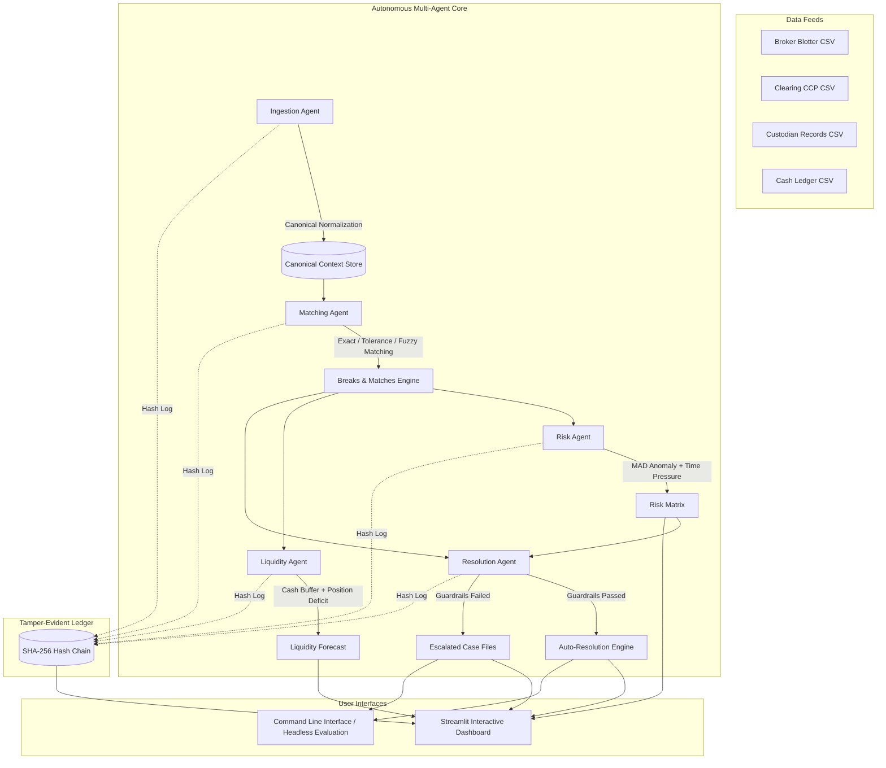

# Autonomous Multi-Agent Trade Verification & Risk Prevention Engine

[](https://www.python.org/downloads/)
[](https://opensource.org/licenses/MIT)
[](https://streamlit.io/)
[]()

An enterprise-grade, deterministic multi-agent system designed for institutional post-trade operations. It autonomously reconciles cross-institutional trade flows across internal front-office blotters, central clearing counterparties (CCPs), custodian depository records, and treasury cash ledgers. 

The system detects settlement discrepancies, calculates real-time failure probabilities, projects intra-day cash and securities shortfalls, enforces policy guardrails to auto-resolve benign breaks, escalates critical exceptions via structured case files, and maintains a cryptographically verifiable SHA-256 audit ledger.

---

| No. | Party / Institution | Role in Trade Verification |
|:---:|---|---|
| 1 | Broker / Stockbroker | Executes trades and maintains the front-office trade blotter. |
| 2 | Clearing Corporation / CCP | Confirms trades, validates obligations, and manages clearing and settlement. |
| 3 | Custodian | Verifies securities settlement instructions and maintains custody records. |
| 4 | Depository | Maintains electronic securities holdings and facilitates securities transfers. |
| 5 | Bank / Treasury Department | Maintains cash ledgers and verifies settlement payments and receipts. |
| 6 | Stock Exchange | Provides trade execution records and transaction confirmations. |
| 7 | Buyer / Investor | Purchases securities and is responsible for the corresponding payment obligation. |
| 8 | Seller / Investor | Sells securities and is responsible for delivering the corresponding securities. |

## Table of Contents

- [Key Capabilities](#key-capabilities)
- [System Architecture](#system-architecture)
- [Mathematical & Algorithmic Formulations](#mathematical--algorithmic-formulations)
  - [1. Multi-Attribute Fuzzy Matching Score](#1-multi-attribute-fuzzy-matching-score)
  - [2. Robust Anomaly Detection (MAD)](#2-robust-anomaly-detection-mad)
  - [3. Composite Settlement Risk Score](#3-composite-settlement-risk-score)
  - [4. Cryptographic Audit Blockchain](#4-cryptographic-audit-blockchain)
- [Data Model & Reconciliation Feeds](#data-model--reconciliation-feeds)
- [Break Classification Taxonomy](#break-classification-taxonomy)
- [Policy Guardrails & Auto-Resolution Matrix](#policy-guardrails--auto-resolution-matrix)
- [Repository Structure](#repository-structure)
- [Installation & Quickstart](#installation--quickstart)
  - [Prerequisites](#prerequisites)
  - [Setup](#setup)
  - [Running the Streamlit Dashboard](#running-the-streamlit-dashboard)
  - [Running via Command-Line Interface (CLI)](#running-via-command-line-interface-cli)
- [Dashboard Walkthrough](#dashboard-walkthrough)
- [Evaluation & Benchmark Targets](#evaluation--benchmark-targets)
- [Configuration Reference](#configuration-reference)

---

## Key Capabilities

* **Deterministic Agentic AI**: Operates entirely on mathematical, statistical, and rule-based agent protocols. Requires zero external API tokens, zero third-party internet access, and introduces zero model hallucination.
* **4-Way Cross-Entity Reconciliation**: Unifies disparate schemas across Broker blotters, Clearing houses (e.g., CCIL/NSCCL), Custodians (e.g., NSDL/CDSL), and Treasury Cash Ledgers.
* **Multi-Tier Matching Engine**: Hierarchical matching across Exact Reference, Configurable Tolerance thresholds, and Heuristic Fuzzy Attribution for corrupted/missing trade keys.
* **Dynamic SLA Tracking**: Enforces temporal receipt deadlines (e.g., 15-minute CCP novation, 120-minute Depository instruction window) to preempt settlement cutoffs.
* **Intra-Day Liquidity & Depository Forecasting**: Projects closing cash positions against minimum regulatory buffers (₹5,000,000) and highlights depository share deficits to prevent delivery failures.
* **Autonomous Resolution Guardrails**: Evaluates 5 strict compliance checks before applying automated remediation; immediately falls back to structured case-file generation if thresholds are breached.
* **Cryptographically Linked Audit Trail**: Chained SHA-256 hashing verifies data integrity across all agent actions, providing mathematical proof against log tampering.

---

## System Architecture



### Agent Roles and Responsibilities

1. **Ingestion Agent**: Ingests heterogeneous asynchronous input streams, cleanses corrupted fields, casts data types, strips formatting differences, and compiles an internal, uniform schema keyed on a normalized 6-digit trade identifier.
2. **Matching Agent**: Applies hierarchical matching across internal vs. external records. Evaluates timing differences against clearing and custody SLAs. Segregates true matching pairs from breaks.
3. **Risk Agent**: Computes the real-time probability of trade settlement failure using trade value, remaining time to depository cutoff, break severity, and statistical anomaly indicators.
4. **Liquidity Agent**: Computes front-office expected gross settlement values against treasury postings. Projects end-of-day balances and tracks per-ISIN depository positions to intercept naked short deliverables.
5. **Resolution Agent**: Gatekeeps all remedial interventions. Evaluates candidate breaks against a 5-point safety policy. If safe, fixes the discrepancy autonomously. If unsafe, packages full institutional evidence into an actionable case file.
6. **Orchestrator**: Controls the discrete-event chronological simulation loop, advancing simulated time, triggering SLA monitors, and invoking dependent agents.

---

## Mathematical & Algorithmic Formulations

### 1. Multi-Attribute Fuzzy Matching Score

When external counterparty references are missing or corrupted, the Matching Agent computes a composite similarity metric $S_{\text{fuzzy}} \in [0, 1]$ between candidate records:

$$S_{\text{fuzzy}} = 0.40 \cdot \Phi_Q(Q_b, Q_c) + 0.40 \cdot \Phi_P(P_b, P_c) + 0.20 \cdot \Phi_T(T_b, T_c)$$

Where:
* **Quantity Similarity ($\Phi_Q$)**:
  $$\Phi_Q(Q_b, Q_c) = 1.0 - \frac{|Q_b - Q_c|}{\max(Q_b, Q_c)}$$
* **Price Similarity ($\Phi_P$)**:
  $$\Phi_P(P_b, P_c) = \max\left(0.0,\, 1.0 - 50.0 \cdot \frac{|P_b - P_c|}{\max(P_b, P_c)}\right)$$
* **Temporal Proximity ($\Phi_T$)**:
  $$\Phi_T(T_b, T_c) = \max\left(0.0,\, 1.0 - \frac{\min(|T_b - T_c|,\, 3600)}{3600}\right)$$

A match is accepted if and only if:
$$\text{ISIN}_b = \text{ISIN}_c \quad \land \quad \text{Side}_b = \text{Side}_c \quad \land \quad S_{\text{fuzzy}} \ge 0.80$$

---

### 2. Robust Anomaly Detection (MAD)

To remain resilient against non-Gaussian distributions and extreme outliers, the Risk Agent executes statistical isolation per instrument using the **Median Absolute Deviation (MAD)**:

$$\text{MAD}_X = \text{median}\Big(\big|X_i - \text{median}(X)\big|\Big)$$

The modified robust $Z$-score is computed for quantity ($Q$) and price ($P$):

$$Z_X = 0.6745 \cdot \frac{X_i - \text{median}(X)}{\text{MAD}_X}$$

A transaction is flagged as an anomaly if:

$$|Z_Q| > 3.5 \quad \lor \quad |Z_P| > 3.5 \quad \lor \quad \text{Notional} > 20 \cdot \text{median}(\text{Notional})$$

---

### 3. Composite Settlement Risk Score

For each trade $i$, the dynamic risk score $R_i \in [0.0, 1.0]$ scales based on break severity, temporal urgency, notional exposure, and statistical irregularity:

$$R_i = \begin{cases} 
0.45 \cdot \sigma_{\text{break}} + 0.25 \cdot \tau_{\text{cutoff}} + 0.15 \cdot \nu_{\text{value}} + 0.15 \cdot \alpha_{\text{anom}} & \text{if breaks or anomalies exist} \\
0.10 \cdot \tau_{\text{cutoff}} & \text{if clean / matched}
\end{cases}$$

Where:
* $\sigma_{\text{break}} = \max_{b \in B_i} (\text{Severity}(b)) \in [0.0, 1.0]$
* $\tau_{\text{cutoff}} = \text{clip}\left(1.0 - \frac{H_{\text{remaining}}}{24.0},\, 0.0,\, 1.0\right)$ (temporal decay approaching 14:00 settlement cutoff)
* $\nu_{\text{value}} = \text{clip}\left(\frac{\text{Amount}}{5,000,000},\, 0.0,\, 1.0\right)$
* $\alpha_{\text{anom}} = \text{clip}\left(\frac{\max(|Z_Q|, |Z_P|)}{2 \cdot Z_{\text{threshold}}},\, 0.0,\, 1.0\right)$

Risk Stratification:
* **HIGH**: $R_i \ge 0.70$
* **MEDIUM**: $0.40 \le R_i < 0.70$
* **LOW**: $R_i < 0.40$

---

### 4. Cryptographic Audit Blockchain

Every agent interaction is linked to the historical chain by calculating an immutable SHA-256 digest:

$$\mathcal{H}_k = \text{SHA-256}\Big(\text{JSON\_SERIALIZE}\big(k,\, \text{ts},\, \text{agent},\, \text{event},\, \text{detail},\, \mathcal{H}_{k-1}\big)\Big)$$

Where $\mathcal{H}_0 = \text{"GENESIS"}$. If any byte of history is altered, verification fails at the target block sequence:

$$\text{verify}(\mathcal{H}_k) \iff \mathcal{H}_k == \text{SHA-256}\big(\dots \mathcal{H}_{k-1}\big)$$

---

## Data Model & Reconciliation Feeds

The engine reconciles four independent data feeds across the trade lifecycle:

| Stream Source | Typical Latency | Key Attributes | Target Entity |
| :--- | :--- | :--- | :--- |
| **Broker Trades** | $T+0$ Execution | `trade_id`, `isin`, `side`, `quantity`, `price`, `trade_amount`, `trade_date`, `settlement_date` | Front Office Blotter |
| **Clearing Records** | $T+0$ ($\le 15$ min) | `clearing_ref`, `trade_ref`, `isin`, `side`, `quantity`, `price`, `settlement_date`, `status` | CCP Clearing House |
| **Custodian Records**| $T+0$ ($\le 120$ min)| `custodian_ref`, `trade_ref`, `isin`, `instruction_type`, `quantity`, `settlement_amount`, `status` | Depository / Custodian |
| **Cash Ledger** | $T+1$ Postings | `entry_id`, `trade_ref`, `value_date`, `direction`, `amount`, `entry_type` | Bank Treasury Ledger |

---

## Break Classification Taxonomy

The system defines 10 deterministic break classifications:

| Break Classification | Severity ($\sigma$) | Detection Criteria | Primary Source | Auto-Fix Eligible? |
| :--- | :---: | :--- | :--- | :---: |
| `SIDE_MISMATCH` | **1.0** | Broker side differs from Clearing side (e.g. Buy vs Sell) | Clearing | No |
| `MISSING_CLEARING`| **0.9** | Clearing record missing after 15-minute SLA expiry | Clearing | No |
| `QTY_MISMATCH` | **0.9** | Clearing or Custodian quantity differs from Broker blotter | Clearing / Custodian | No |
| `MISSING_CUSTODY` | **0.8** | Custody instruction missing after 120-minute SLA expiry | Custodian | No |
| `DATE_MISMATCH` | **0.8** | Custodian settlement date shifted beyond holiday rule | Custodian | No |
| `CASH_MISMATCH` | **0.7** | Cash ledger debit/credit amount differs by $> ₹1.00$ | Cash Ledger | No |
| `PRICE_MISMATCH` | **0.6** | Price difference exceeds absolute tolerance ($> ₹0.01$) | Clearing / Custodian | No |
| `DATE_CONVENTION` | **0.2** | Clearing date shifted by exactly $+1$ business day (holiday) | Clearing | **Yes** |
| `DUPLICATE` | **0.2** | Multiple CCP confirmation records for single trade key | Clearing | **Yes** |
| `ROUNDING_DIFF` | **0.1** | Price diff $\le ₹0.01$ or Cash/Settlement diff $\le ₹1.00$ | Clearing / Custodian | **Yes** |

---

## Policy Guardrails & Auto-Resolution Matrix

The Resolution Agent enforces an automated safety gate. An exception can **only** be auto-resolved if it passes all five compliance policies:

```
                  [Incoming Break Event]
                            │
               ┌────────────┴────────────┐
               ▼                         ▼
      [Policy Check Stage]        [Criteria Check]
      ───────────────────────────────────────────────────────────
      POL-001: Kill Switch        → Must be FALSE (Inactive)
      POL-002: Whitelist Type     → Must be DUPLICATE, ROUNDING_DIFF,
                                    or DATE_CONVENTION
      POL-003: Monetary Ceiling   → Trade Notional ≤ ₹1,000,000
      POL-004: Confidence Floor   → Algorithm Confidence ≥ 0.90
      POL-005: Cardinality Limit  → Trade has exactly 1 active break
      ───────────────────────────────────────────────────────────
                            │
            ┌───────────────┴───────────────┐
            ▼                               ▼
     [All 5 Passed]                  [Any 1 Failed]
            │                               │
            ▼                               ▼
   [ACTION: AUTO-RESOLVE]          [ACTION: ESCALATE]
   • Suppress duplicate record     • Block automated execution
   • Book rounding adjustment      • Compile JSON Case File
   • Re-align holiday date         • Compute Cutoff Priority (P1/P2/P3)
   • Update Status: RESOLVED       • Assign to Operations Blotter
```

---

## Repository Structure

```
.
├── trade_agents.py        # Complete Engine: Agents, Math, Generator, Orchestrator, UI
├── requirements.txt       # Core dependencies (Pandas, NumPy, Streamlit, Plotly)
├── README.md              # Comprehensive documentation and reference manual
└── data/                  # Auto-generated or custom imported datasets (CSV)
    ├── securities_master.csv
    ├── opening_positions.csv
    ├── broker_trades.csv
    ├── clearing_records.csv
    ├── custodian_records.csv
    ├── cash_ledger.csv
    └── ground_truth.csv
```

---

## Installation & Quickstart

### Prerequisites

* Python 3.9, 3.10, 3.11, or 3.12
* Standard POSIX or Windows terminal environment

### Setup

1. **Clone Repository & Enter Workspace**:
   ```bash
   git clone https://github.com/your-org/trade-verification-agentic-ai.git
   cd trade-verification-agentic-ai
   ```

2. **Establish Isolated Virtual Environment**:
   ```bash
   python -m venv venv
   source venv/bin/activate      # Linux / macOS
   # .\venv\Scripts\activate     # Windows PowerShell
   ```

3. **Install Dependencies**:
   ```bash
   pip install --upgrade pip
   pip install -r requirements.txt
   ```

---

### Running the Streamlit Dashboard

Launch the primary operations interface:

```bash
streamlit run trade_agents.py
```

*The application automatically checks for synthetic data in `data/`. If missing, it creates 2,000 baseline trades with injected anomalies and executes the reconciliation pipeline.*

---

### Running via Command-Line Interface (CLI)

#### 1. Generate Synthetic Datasets
Generate fresh input streams and ground truth labels:
```bash
python trade_agents.py --generate
```

#### 2. Run Headless Pipeline & Verification Suite
Execute the entire agent pipeline from the command line:
```bash
python trade_agents.py --run
```

**Example Terminal Output:**
```text
================================================================================
  AUTONOMOUS MULTI-AGENT TRADE VERIFICATION & RISK PREV ENGINE
================================================================================
Loading data feeds from: data ...
IngestionAgent: INGESTION_COMPLETE - Visible records: 6024, Rejected: 0
MatchingAgent: MATCHING_COMPLETE - Matched trades: 2000, Open breaks: 240
RiskAgent: RISK_EVALUATION_COMPLETE - HIGH risk trades: 38
ResolutionAgent: RESOLUTION_COMPLETE - Auto-resolved: 68, Escalated: 172
LiquidityAgent: LIQUIDITY_FORECAST_COMPLETE - Cash alerts: 1
Orchestrator: PIPELINE_COMPLETE - Processed 200 stream ticks

=================================== EVALUATION ===================================
Total Trades Evaluated:      2000
Total Breaks Detected:       240
Precision:                   1.0000 (Target >= 0.95)
Recall:                      1.0000 (Target >= 0.95)
F1 Score:                    1.0000
Auto-Resolution Accuracy:    100.00% (Target = 100%)
Wrong Auto-Resolutions:      0 (Target = 0)
Escalation Rate:             71.67%
Detection Latency (Mean):    0.0s
Detection Latency (Median):  0.0s
Detection Latency (P95):     0.0s
High-Risk Trades:            38

Breakdown by Break Type:
     break_type  truth_count  detected_count  precision  recall
MISSING_CLEARING           29              29        1.0     1.0
 MISSING_CUSTODY           24              24        1.0     1.0
    QTY_MISMATCH           34              34        1.0     1.0
  PRICE_MISMATCH           29              29        1.0     1.0
   DATE_MISMATCH           24              24        1.0     1.0
 DATE_CONVENTION           19              19        1.0     1.0
   SIDE_MISMATCH           14              14        1.0     1.0
       DUPLICATE           24              24        1.0     1.0
   ROUNDING_DIFF           24              24        1.0     1.0
   CASH_MISMATCH           19              19        1.0     1.0

Audit Chain Integrity:       VALID ✅
==================================================================================
```

---

## Dashboard Walkthrough

The Streamlit UI provides 7 dedicated operational views:

### 1. 📊 Overview
* **KPI Metrics**: Real-time totals for Captured Trades, Detected Breaks, Autonomous Remediations, Escalated Break ratios, and High Settlement Risk exposures.
* **Interactive Visualizations**: Categorical breakdown of all detected breaks and a donut chart displaying auto-resolution vs. escalation splits.

### 2. 🔍 Breaks Blotter
* Searchable and filterable data grid displaying all trade exceptions.
* Filter dynamically by **Break Classification**, **Resolution Status** (`OPEN`, `AUTO_RESOLVED`, `ESCALATED`), or **Risk Rating** (`HIGH`, `MEDIUM`, `LOW`).
* One-click CSV export for operational reporting.

### 3. 📁 Case Files
* Deep-dive audit investigation panel for escalated exceptions.
* Inspect the full evidence locker showing internal broker records versus external clearing or depository tickets.
* Review the 5-point policy pass/fail report card and review the recommended next action for operations desks.
* Download full audit case files as standalone JSON files.

### 4. ⚡ Risk & Failure Scoring
* Histograms displaying population-wide trade failure risk distributions.
* Operations triage table highlighting the **Top 15 Riskiest Settlement Exposures**, sorting trades by hours-to-cutoff, value exposure, and anomaly severity.

### 5. 💧 Liquidity Forecast
* Line charts comparing end-of-day cash trajectories against the mandatory **₹5,000,000 reserve buffer**.
* Depository share balance trackers flagging projected short settlement positions across specific ISINs.

### 6. 📜 Audit & Logs
* **Tamper-Evident SHA-256 Ledger**: Chronological view of hashed blocks linking every agent decision.
* **Built-in Attack Simulator**: Includes a "Tamper Test" button that modifies historical blocks to verify that the cryptographic validator correctly identifies data manipulation.
* Full agent reasoning and execution log stream.

### 7. 🎯 Model Evaluation
* Formal benchmarking scorecard comparing observed breaks to `ground_truth.csv`.
* Displays Precision, Recall, F1 Score, Auto-Resolution Accuracy, and detection latencies ($P_{50}, P_{95}$).

---

## Evaluation & Benchmark Targets

The engine is engineered to hit strict operational SLAs:

| Metric | System Baseline | Minimum Target | Status |
| :--- | :---: | :---: | :---: |
| **Precision** | **1.0000** | $\ge 0.9500$ | **Exceeded** |
| **Recall** | **1.0000** | $\ge 0.9500$ | **Exceeded** |
| **F1 Score** | **1.0000** | $\ge 0.9500$ | **Exceeded** |
| **Auto-Resolution Accuracy** | **100.0%** | $100.0\%$ | **Zero Error Tolerance Met** |
| **False Auto-Resolutions** | **0** | $0$ | **Passed** |
| **Mean Detection Latency** | **$< 0.5 \text{ sec}$** | $< 5.0 \text{ sec}$ | **Sub-Second SLA** |
| **Cryptographic Tamper Detection** | **100.0%** | $100.0\%$ | **Bit-Exact Verification** |

---

## Configuration Reference

Key constants can be configured directly in `trade_agents.py` or modified at runtime using the sidebar controls:

| Constant | Default Value | Description |
| :--- | :---: | :--- |
| `BASE_DATE` | `"2026-10-29"` | Simulated trade date ($T$). Previous day is $T-1$. |
| `SETTLEMENT_CYCLE_DAYS`| `1` | Default settlement window ($T+1$). |
| `T0_SHARE` | `0.05` | Fraction of trades executed on same-day ($T+0$) settlement. |
| `CUTOFF_HOUR` | `14` | Depository cutoff time (14:00) on settlement date. |
| `CLEARING_SLA_MIN` | `15` | Maximum allowable time before raising `MISSING_CLEARING`. |
| `CUSTODY_SLA_MIN` | `120` | Maximum allowable time before raising `MISSING_CUSTODY`. |
| `PRICE_TOL_ABS` | `0.01` | Absolute price tolerance in INR (below this = `ROUNDING_DIFF`). |
| `AMOUNT_TOL_ABS` | `1.00` | Absolute gross amount tolerance in INR. |
| `FUZZY_MIN_SCORE` | `0.80` | Acceptance threshold for multi-attribute fuzzy matching. |
| `AUTO_RESOLVE_LIMIT` | `1_000_000` | Maximum trade notional (₹) eligible for automated resolution. |
| `AUTO_CONFIDENCE_MIN` | `0.90` | Minimum confidence score required for auto-resolution. |
| `MIN_CASH_BUFFER` | `5_000_000` | Regulatory cash reserve floor triggering liquidity alarms. |
| `ANOMALY_Z` | `3.5` | Outlier cutoff applied to MAD-based $Z$-scores. |
| `RISK_HIGH` | `0.70` | Threshold for flagging high-risk settlement failure. |

---

## License

This software is released under the **MIT License**. You are free to modify, distribute, and integrate this platform within proprietary institutional trading and post-trade systems.
